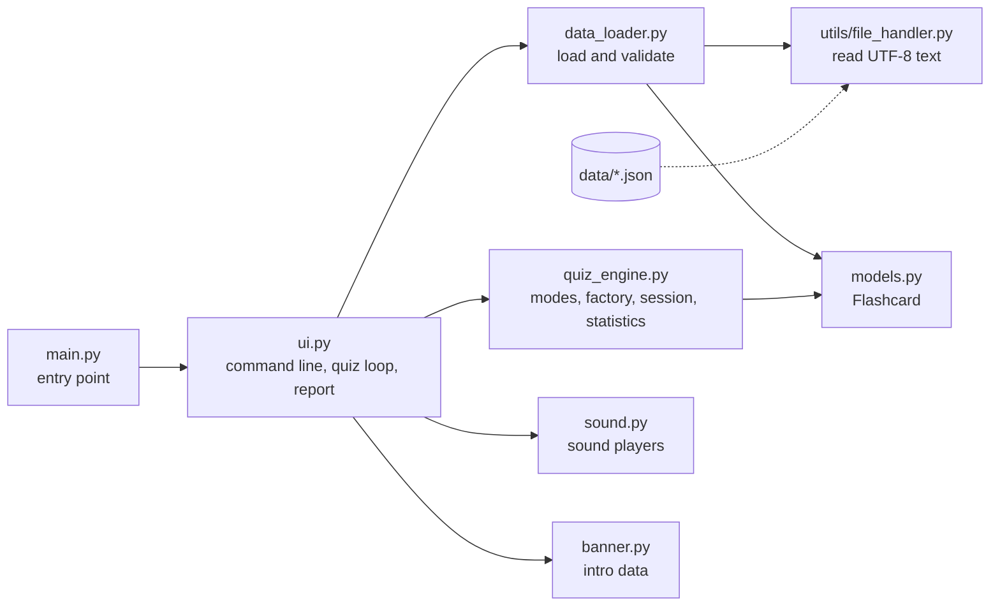
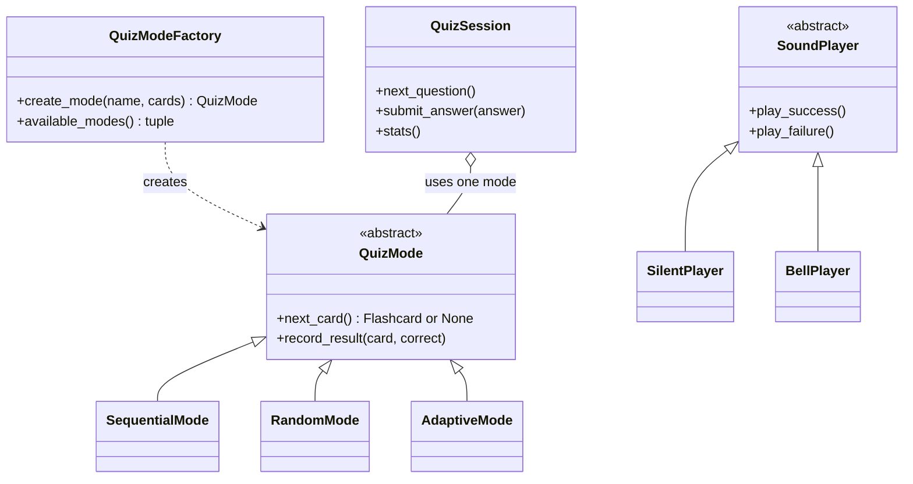

# Flashcard Quizzer


A command-line application that quizzes you with flashcards loaded from a JSON file. It has three quiz modes (sequential, random and adaptive), colored feedback, a final statistics report and an arcade-style intro. It uses only the Python standard library.

It was built for the AI-Powered Software Engineer course by directing an AI coding agent (Claude Code) with small, reviewed prompts. Every interaction is documented in [`docs/ai_edit_log.md`](docs/ai_edit_log.md).

## Features

- **Three quiz modes**, chosen with `-m`: sequential (first card to last), random (shuffled) and adaptive (cards that you miss come back after a few questions, and a card is retired after three failures).
- **Decks in two JSON formats**, validated on load. A missing file or a bad card gives a one-line message, never a traceback.
- **Immediate feedback**: green for a correct answer, red for an incorrect one, with the right answer shown.
- **Final report** with an accuracy bar, a rank from S to D and the list of missed terms. With `--stats` you get the full report.
- **`--limit N`** stops the quiz after N answered questions, in any mode.
- **`--sound`** rings the terminal bell after each answer (one ring if correct, three if incorrect).
- **Intro banner** with the mode and the size of the deck, shown when you start the program.
- **Clean exit**: type `exit` or press Ctrl+C at any time.
- **Three decks included**: a glossary of 10 acronyms, 8 Python basics questions and the periodic table (the symbol and the atomic number of the 118 elements, 236 cards).
- **Quality**: modular code with the Strategy and Factory patterns, type hints everywhere, 482 tests and 100 percent coverage of the application code.

## Requirements and installation

- Python 3.10 or higher. The test suite runs on Python 3.10, 3.12 and 3.14 in GitHub Actions.
- The application has **no runtime dependencies**. `requirements.txt` only lists the development tools (pytest, pytest-cov, black, isort, flake8 and mypy).

On Windows (PowerShell):

```powershell
python -m venv venv
venv\Scripts\Activate.ps1
python -m pip install -r requirements.txt
```

On Linux or macOS:

```bash
python3 -m venv venv
source venv/bin/activate
python -m pip install -r requirements.txt
```

## Usage

```
python main.py -f FILE [-m {adaptive,random,sequential}] [--limit N] [--sound] [--stats]
```

| Option | Meaning |
|---|---|
| `-f`, `--file` | Path of the JSON deck to load (required) |
| `-m`, `--mode` | `sequential` (default), `random` or `adaptive` |
| `--limit N` | Stop after N answered questions. Repeated questions count. N must be a positive integer |
| `--sound` | Ring the terminal bell after each answer (see [Sound](#sound)) |
| `--stats` | Show the full statistics report at the end |
| `-h`, `--help` | Show all the options |

Examples:

```bash
python main.py --help
python main.py --mode sequential --file data/glossary.json
python main.py -m adaptive -f data/python_basics.json
python main.py -m random -f data/periodic_table.json --limit 10
python main.py -f data/glossary.json --stats
python main.py -f data/glossary.json --limit 5 --sound
```

### A short session

This is `python main.py -f data/glossary.json --limit 3` where the user answers the second question wrongly. It is shown in plain text: in a terminal the frame and the small texts of the banner are green, the big letters are dark yellow, and the feedback is green or red.

```
+==========================================================+
|                                                          |
|  ##### #      ###   #### #   #  ####  ###  ####  ####    |
|  #     #     #   # #     #   # #     #   # #   # #   #   |
|  ####  #     #####  ###  ##### #     ##### ####  #   #   |
|  #     #     #   #     # #   # #     #   # #  #  #   #   |
|  #     ##### #   # ####  #   #  #### #   # #   # ####    |
|                                                          |
|         ###  #   # ##### ##### ##### ##### ####          |
|        #   # #   #   #      #     #  #     #   #         |
|        # # # #   #   #     #     #   ####  ####          |
|        #  #  #   #   #    #     #    #     #  #          |
|         ## #  ###  ##### ##### ##### ##### #   #         |
|                                                          |
|               LEARN IT. QUIZ IT. BEAT IT.                |
|              SEQUENTIAL * RANDOM * ADAPTIVE              |
+----------------------------------------------------------+
|      READY PLAYER 1   MODE: SEQUENTIAL   CARDS: 10       |
+==========================================================+

Q1: API
> Application Programming Interface
Correct!
Q2: CDN
> x
Incorrect. Answer: Content Delivery Network
Q3: CPU
> central processing unit
Correct!
Quiz finished.

+==========================================================+
|                      SESSION REPORT                      |
+==========================================================+
| Total questions    3                                     |
| Accuracy           [#############-------]  66.7%         |
| Rank               C                                     |
+----------------------------------------------------------+
| Missed terms                                             |
|   - CDN                                                  |
+==========================================================+
```

### The full report

`--stats` replaces the short report with this one (adaptive mode, 9 questions, one of them wrong):

```
+==========================================================+
|                      SESSION REPORT                      |
+==========================================================+
| Mode               adaptive                              |
| Deck file          data/python_basics.json               |
| Deck size          8                                     |
| Session            finished                              |
+----------------------------------------------------------+
| Total questions    9                                     |
| Correct answers    8                                     |
| Incorrect answers  1                                     |
| Accuracy           [##################--]  88.9%         |
| Rank               B                                     |
+----------------------------------------------------------+
| Missed terms                                             |
|   - Which keyword handles an exception raised in a try   |
|     block?                                               |
+==========================================================+
```

The rank is **S** for 100 percent, **A** from 90 percent, **B** from 75 percent, **C** from 60 percent and **D** below that. With no answered questions it is `-`.

### How the quiz works

- An answer is correct if it matches the back of the card, **ignoring letter case and the spaces at the start and the end**. Spaces inside the answer count. An empty answer is always incorrect.
- **Sequential** asks the cards in file order. **Random** shuffles them once. Both ask each card once.
- **Adaptive** asks every card once, and a card that you miss comes back after a rest that grows with the deck (a tenth of the deck, between 2 and 10 questions). A card that you miss three times is retired. The same card is never asked twice in a row unless it is the only one left. Repeated questions are labelled `(review)`.
- Type `exit` (in any letter case) or press Ctrl+C to stop. A question that was shown but not answered does not count.
- With `--limit N` the quiz ends as normal (`Quiz finished.`) after N answered questions, even if some cards are still pending.

| Exit code | Meaning |
|---|---|
| 0 | The quiz finished or you quit with `exit` or Ctrl+C |
| 1 | The deck could not be loaded (missing file, bad JSON, bad card) |
| 2 | Invalid command line arguments |

A bad deck gives one readable line:

```
Error: File not found: "missing.json".
```

## Decks

A deck is a JSON file in one of two formats:

```json
[
  {"front": "API", "back": "Application Programming Interface"},
  {"front": "CDN", "back": "Content Delivery Network"}
]
```

```json
{"cards": [
  {"front": "Which keyword defines a function?", "back": "def"}
]}
```

Every card needs a non-empty `front` and `back` (text). Spaces around them are removed and extra keys are ignored. The file is read as UTF-8. If a card is wrong, the message names its position, counting from 1.

| Deck | Format | Cards |
|---|---|---|
| `data/glossary.json` | Array | 10 acronyms and their meaning |
| `data/python_basics.json` | Object | 8 Python questions |
| `data/periodic_table.json` | Array | 236: the chemical symbol and the atomic number of the 118 elements, with the IUPAC spelling of the names |

The periodic table is long, so use it with `--limit`, for example `python main.py -m random -f data/periodic_table.json --limit 10`. You can add your own decks to `data/`.

## Sound

`--sound` writes the terminal bell character to the standard error stream after each answer: **one ring** for a correct answer and **three rings** for an incorrect one. It is off by default, and nothing is written without the flag.

The bell is played by your terminal, so the result depends on it:

- In the VS Code terminal you may need to turn it on in your **user** settings: `"accessibility.signals.terminalBell": { "sound": "on" }`.
- The bell cannot change its pitch or its length. Some terminals limit how many bells they play per second, so the three rings may sound like one. In the development terminal, a correct and an incorrect answer sounded alike.
- If your terminal has the bell turned off, there is no sound.

## Project structure

```
Flashcard-Quizzer/
├── main.py                  # Entry point: starts the quiz with the intro banner
├── ui.py                    # Command line, quiz loop, feedback and report (talks to the user)
├── quiz_engine.py           # Quiz modes (Strategy), factory, session and statistics (no input or output)
├── data_loader.py           # Loads and validates a deck, raises FlashcardLoadError
├── models.py                # The Flashcard dataclass
├── sound.py                 # Sound players: silent (null object) and terminal bell
├── banner.py                # Data of the intro banner
├── utils/
│   └── file_handler.py      # Reads a text file as UTF-8, with or without BOM
├── data/                    # The three decks
├── tests/                   # 482 pytest tests; helpers.py holds the shared helpers
├── docs/
│   ├── ai_edit_log.md       # AI interaction log
│   ├── coverage_report.txt  # Coverage report (the HTML report is not stored in Git)
│   ├── design_patterns.md   # Pattern reference of the course
│   ├── final_report.md      # Final project report
│   └── report_template.md   # Template of the final report
├── ai_guidance/             # Prompting and code review guides of the course
├── .claude/                 # Claude Code configuration and the definition of done
├── .github/workflows/tests.yml   # Continuous integration
├── pyproject.toml           # black, isort and coverage configuration
├── .flake8, mypy.ini        # Linter and type checker configuration
└── requirements.txt         # Development tools
```

## Architecture

How the modules depend on each other. The arrows point from the module that uses to the module that is used.



The Strategy and Factory patterns. A quiz mode and a sound player are interchangeable strategies, and the session and the interface never ask which one they have.



## Development

Run everything from the project folder, with the virtual environment active:

```bash
python -m pytest tests/                        # the test suite
python -m pytest --cov=. --cov-report=html     # coverage, report in htmlcov/
python -m black --check .
python -m isort --check .
python -m flake8 .
python -m mypy .
```

- The coverage is configured in `pyproject.toml`: it measures the application code only (not the tests), counts branches and fails below 90 percent. Today it is **446 statements and 118 branches, all covered**. The report is saved in [`docs/coverage_report.txt`](docs/coverage_report.txt).
- Type hints are required on every function (`mypy` is strict about it), and the tests use pytest with no mocking library.
- **GitHub Actions** runs the formatting and the linters on Python 3.14 and the tests with coverage on Python 3.10, 3.12 and 3.14 for every push and pull request.

## Design

- **Separation of concerns.** `quiz_engine.py` knows nothing about the screen or the keyboard, and `ui.py` has no quiz logic, so the engine can be tested alone. The loader validates, `models.py` holds the data and `utils/file_handler.py` only reads files.
- **Strategy pattern.** The three modes are different algorithms to choose the next card, so each one is a subclass of `QuizMode`, and `QuizSession` uses whichever it receives. Adding a mode means writing one class.
- **Factory pattern.** `QuizModeFactory.create_mode(name, cards)` returns a new mode from the name given on the command line. A new mode is also one entry in its registry, and nothing else changes.
- **Sound.** The sound players follow the same idea: the interface calls `play_success()` or `play_failure()` on a `SoundPlayer`, and a silent player (a null object) is used when `--sound` is not given, so the interface needs no `if`.

## Known limitations

- The word `exit` is reserved. A card whose correct answer is `exit` cannot be answered correctly.
- Answers ignore letter case, so `fe` is accepted for `Fe`. No pair of symbols in the periodic table deck differs only by case.
- The colors are ANSI codes. If you redirect the output to a file, the codes are written too.
- The sound depends on the terminal (see [Sound](#sound)).
- The intro appears only when the program starts from `main.py`.

## Documentation

- [`docs/ai_edit_log.md`](docs/ai_edit_log.md): the log of the AI interactions, with the prompts, the reviews and the lessons.
- [`docs/final_report.md`](docs/final_report.md): the final project report.
- [`docs/coverage_report.txt`](docs/coverage_report.txt): the test coverage report.
- [`docs/design_patterns.md`](docs/design_patterns.md): the pattern reference of the course.
